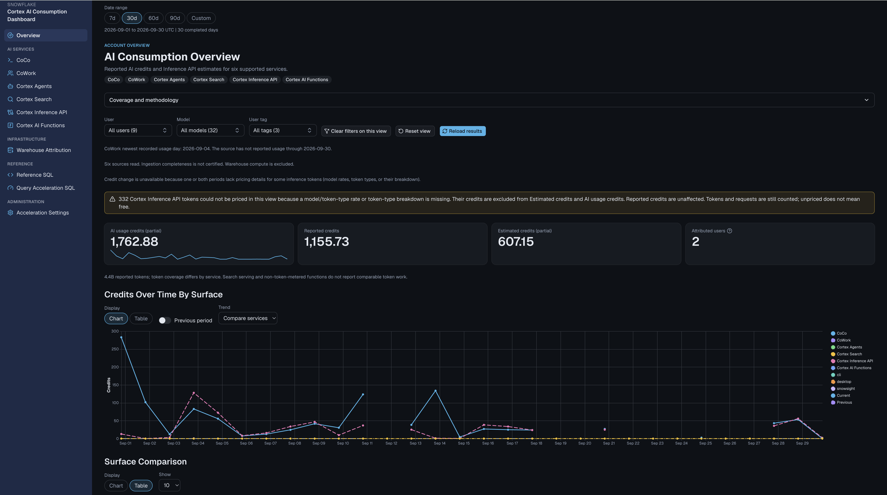

# Cortex AI Consumption Dashboard

[](LICENSE)

A dashboard that tracks credits, tokens, and requests across the major Cortex AI surfaces in
Snowflake, plus their virtual-warehouse compute. The project ships the same dashboard in two
application interfaces. Both have the same pages, metrics, filters, URL parameters, and
Acceleration Settings administration, and both read the same `ACCOUNT_USAGE` views,
configuration table, and optional acceleration layer. Pick the interface you prefer; you can
also run both side by side.

| Interface | Runtime | Choose it if you prefer |
| --- | --- | --- |
| Streamlit | Streamlit in Snowflake, container runtime (`streamlit_app.py`, `app_pages/`, `utils/`) | A Python app with native Streamlit controls, opened from Snowsight |
| App Runtime | Next.js on Snowflake App Runtime (`web/`) | A web application at its own URL, signed in through Snowflake |

The two are kept identical by tests: the web SQL builders must match the Python ones byte for
byte, and the aggregations must agree to 1e-9. The differences are interface details:

- **Administrator allowlist.** Streamlit reads `admin_access.toml`; App Runtime reads the
  `DASHBOARD_ADMIN_USERS` variable in `web/app.yml`. Both ship empty, so nobody can administer
  until you add usernames.
- **Reload.** Streamlit's **Reload results** clears the active page's cached queries. In App
  Runtime, administrators get **Reload results** and other viewers get **Refetch cached
  results**, which can reuse the cache.
- **Loading.** Streamlit shows a loading dialog; App Runtime shows a loading panel.

I built it to see how far you can get on nothing but Snowflake and the `ACCOUNT_USAGE` views
every account already has. Out of the box there is no ETL and no pipeline: hosted apps read
those views inside Snowflake. Local live previews retrieve account data to your machine and
need the protections in [Development setup](CONTRIBUTING.md#development-setup). The optional
acceleration layer adds scheduled tables that pre-aggregate the same views, still entirely
inside Snowflake with native Tasks and no external tooling. It is a working cost dashboard, but
the pattern is half the point, so the SQL is written to be read rather than tuned. This is a
personal project, not a supported Snowflake product.

The **Reference SQL** page shows baseline direct-source SQL from the shared builders for
the selected window. It does not reproduce in-memory filters, comparison-window expansion,
or accelerated routing. Review displayed SQL before running it; nullable model rates render
as SQL `NULL`. See [the metrics contract](docs/DASHBOARD_METRICS.md#coverage).
The **Query Acceleration SQL** page shows the build, refresh, read, and lifecycle SQL
for the optional aggregate layer, also generated from the app's builders.



The Overview page in the App Runtime interface; the Streamlit interface shows the same page with
native Streamlit controls. The figures are a captured example, not live data or a guarantee of
complete source coverage. See the metrics contract below for the meaning and limitations of
each measure.

## Contents

- [Quick start](#quick-start)
- [Setup, deployment, and teardown](#setup-deployment-and-teardown)
- [What it covers](#what-it-covers)
- [Pages](#pages)
- [How it works](#how-it-works)
- [Data and latency](#data--latency)
- [Deployment reference](#deployment-reference)
- [Contributing](#contributing)
- [Author](#author)
- [License](#license)

## Quick start

Run everything from the repository root with an explicit Snowflake CLI connection. `bootstrap`,
`acceleration:provision`, and `grants` print their plan and change nothing without the shown
`CONFIRM`; run each once without it to review. The full walkthrough, with roles, objects, and
teardown, is [Setup, deployment, and teardown](#setup-deployment-and-teardown).

```bash
make doctor
make inspect CONNECTION=my_connection
make bootstrap CONNECTION=my_connection EXPECTED_ACCOUNT=MYORG-MYACCOUNT DATABASE=COST_MGMT_DB SCHEMA=PUBLIC CONFIRM=COST_MGMT_DB.PUBLIC
# Create the two roles (SQL in step 4 below), then optionally:
make acceleration:provision CONNECTION=my_connection EXPECTED_ACCOUNT=MYORG-MYACCOUNT CONFIRM=COST_MGMT_DB.PUBLIC
make grants CONNECTION=my_connection EXPECTED_ACCOUNT=MYORG-MYACCOUNT VIEWER_ROLE=COST_MGMT_DASHBOARD_VIEWER ADMIN_ROLE=COST_MGMT_DASHBOARD_ADMIN QUERY_WAREHOUSE=COMPUTE_WH GRANT_ACCOUNT_USAGE=1 CONFIRM=COST_MGMT_DASHBOARD_VIEWER
```

Then deploy the interface you prefer, or both, as the admin role:

```bash
# Streamlit
SNOWFLAKE_CONNECTIONS_MY_CONNECTION_ROLE=COST_MGMT_DASHBOARD_ADMIN make deploy:streamlit CONNECTION=my_connection APP_NAME=AI_CONSUMPTION_DASHBOARD APP_TITLE="Cortex AI Consumption Dashboard"
# App Runtime
SNOWFLAKE_CONNECTIONS_MY_CONNECTION_ROLE=COST_MGMT_DASHBOARD_ADMIN make deploy:app-runtime CONNECTION=my_connection TARGET=test CONFIRM_EXAMPLE_TARGET=test
```

Run `make` for the full command list. [Operations](docs/OPERATIONS.md) is the per-command
reference: side effects, inputs, confirmations, and which commands are safe to rerun.

To run either interface locally against live data, follow
[Development setup](CONTRIBUTING.md#development-setup). Live previews read real account data
and listen only on loopback; see [Live local preview](docs/OPERATIONS.md#live-local-preview).

```bash
make install
make smoke:streamlit-live CONNECTION=my_connection
make smoke:app-runtime-live CONNECTION=my_connection
```

## Setup, deployment, and teardown

The steps are the same for both interfaces until step 7, where you deploy one or both. Steps 1–6
are done once per account. This `make` sequence, including both deploys, was verified end to
end on a clean account on October 8, 2026, with `ACCOUNTADMIN` as the installer.

### Prerequisites

- GNU Make 3.81 or later, uv, and Python 3.11.
- Node.js 22.12 or later on the 22.x line, for the App Runtime interface and the web checks.
- Snowflake CLI 3.27 or later, with a connection in `~/.snowflake/connections.toml`.

`make doctor` checks these without contacting Snowflake; `make install` installs the Python and
web dependencies.

### What gets created

| Object | Created by | Used by |
| --- | --- | --- |
| Database `COST_MGMT_DB`, schema `PUBLIC`, table `CORTEX_DASHBOARD_CONFIG` | `make bootstrap` | Both |
| Roles `COST_MGMT_DASHBOARD_VIEWER` and `COST_MGMT_DASHBOARD_ADMIN` | You, with the SQL in step 4 | Both |
| Warehouse `COST_MGMT_WH`, ten `COST_MGMT_*` aggregate tables, ten `COST_MGMT_TASK_*` tasks | `make acceleration:provision` or Acceleration Settings (optional) | Both |
| Streamlit app, for example `COST_MGMT_DB.PUBLIC.AI_CONSUMPTION_DASHBOARD` | `make deploy:streamlit` | Streamlit |
| Application Service, for example `COST_MGMT_DB.PUBLIC.AI_CONSUMPTION_WEB_TEST`, and its artifact repository `<SERVICE>_REPO` | `make deploy:app-runtime` | App Runtime |

The deploy also uses objects it does not create: the query warehouse `COMPUTE_WH` (both
interfaces), the compute pool `SYSTEM_COMPUTE_POOL_CPU` and Snowflake's PyPI repository
`SNOWFLAKE.SNOWPARK.PYPI_SHARED_REPOSITORY` (Streamlit), and the `SNOWFLAKE.ACCOUNT_USAGE` views.
An App Runtime deploy also creates a `<SERVICE>_CODE` upload stage and drops it once the build
finishes.

### Roles

| Role | Purpose | Privileges |
| --- | --- | --- |
| Installer, such as `ACCOUNTADMIN` | Runs steps 2–6 | Create the database, roles, and task warehouse; run tasks; grant the SNOWFLAKE database roles |
| `COST_MGMT_DASHBOARD_ADMIN` | Owns and deploys the apps. Both interfaces run with their owner's privileges, so this role is what reads `ACCOUNT_USAGE`. | From `make grants`: read access to the database, schema, query warehouse, config table, and aggregate tables; `INSERT, UPDATE` on the config table; `CREATE STREAMLIT`, `CREATE STAGE`, `CREATE APPLICATION SERVICE`, and `CREATE ARTIFACT REPOSITORY` on the schema; `USAGE` on the compute pool; `SNOWFLAKE.PYPI_REPOSITORY_USER`; and, with `GRANT_ACCOUNT_USAGE=1`, `SNOWFLAKE.USAGE_VIEWER`, `GOVERNANCE_VIEWER`, and `SECURITY_VIEWER` |
| `COST_MGMT_DASHBOARD_VIEWER` | Opens the apps | From `make grants`: the same read access, plus `USAGE` on all current and future Streamlit apps and Application Services in the schema |

Roles control who can open an app. Who can administer Acceleration Settings inside an app is a
separate username allowlist, set in step 1.

The acceleration tasks are owned by the installer role that provisions them and run as that
role. Provisioning from Acceleration Settings instead needs an app owner with `CREATE TABLE`,
`CREATE TASK`, `CREATE WAREHOUSE`, and `EXECUTE TASK`, which `make grants` does not give. Keep
that kind of owner in an admin-only deployment; viewer allowlisting does not reduce the app
owner's Snowflake privileges.

### 1. Configure

Review the committed customer example values before creating anything:

- **Location.** Both interfaces read the config table from `COST_MGMT_DB.PUBLIC`, and
  `make bootstrap` refuses any other location. To relocate, edit `snowflake.yml`, `web/app.yml`,
  and `sql/setup.sql` together.
- **Streamlit (`snowflake.yml`).** `query_warehouse` (`COMPUTE_WH`) and `compute_pool`
  (`SYSTEM_COMPUTE_POOL_CPU`). The app name and title are passed at deploy time.
- **App Runtime (`web/app.yml`).** The service name per target (`dev` in your personal `USER$`
  database, which cannot be shared with other roles; `test`; `prod`) and `query_warehouse`.
- **Administrators.** Acceleration Settings and every mutation fail closed unless the signed-in
  Snowflake username is allowlisted. For Streamlit, set `users` in `admin_access.toml`, for
  example `users = ["DASHBOARD_ADMIN"]`. For App Runtime, set the `DASHBOARD_ADMIN_USERS` JSON
  array in `web/app.yml`; a target's `environment_variables` list replaces the top-level list,
  so repeat every variable in a target that overrides one. Both ship empty. Neither app treats
  the owner's identity, a URL parameter, or session state as authorization. Keep local preview
  allowlists empty: a local server has no sign-in boundary; see
  [local preview safety](docs/OPERATIONS.md#live-local-preview).

### 2. Confirm the account

```bash
make inspect CONNECTION=my_connection
```

Read-only. It shows the connection's account, role, and warehouse, and the config registry once
it exists; before bootstrap it reports that the config table is not readable. Use its
`ACCOUNT_ID` (or locator) as `EXPECTED_ACCOUNT` in every command that changes the account.

### 3. Bootstrap the config table

```bash
make bootstrap CONNECTION=my_connection EXPECTED_ACCOUNT=MYORG-MYACCOUNT DATABASE=COST_MGMT_DB SCHEMA=PUBLIC CONFIRM=COST_MGMT_DB.PUBLIC
```

`sql/setup.sql` creates the database, schema, and `CORTEX_DASHBOARD_CONFIG` key-value table with
`IF NOT EXISTS`, so rerunning it keeps existing objects and settings. The executing role needs
`CREATE DATABASE` on the account (or an existing database it can create a schema in) and
`CREATE TABLE` on the schema.

### 4. Create the roles

`make grants` grants only to roles that already exist. Create them, roll them up to `SYSADMIN`,
and grant the admin role to whoever deploys:

```sql
CREATE ROLE IF NOT EXISTS COST_MGMT_DASHBOARD_VIEWER;
CREATE ROLE IF NOT EXISTS COST_MGMT_DASHBOARD_ADMIN;
GRANT ROLE COST_MGMT_DASHBOARD_VIEWER TO ROLE COST_MGMT_DASHBOARD_ADMIN;
GRANT ROLE COST_MGMT_DASHBOARD_ADMIN TO ROLE SYSADMIN;
GRANT ROLE COST_MGMT_DASHBOARD_ADMIN TO USER <deployer>;
```

### 5. Provision the acceleration layer (optional)

The acceleration layer is a dedicated warehouse plus per-surface aggregate tables refreshed
nightly, so pages read pre-computed rows instead of scanning `ACCOUNT_USAGE`. It is worth it on
large accounts where cold `ACCOUNT_USAGE` reads are slow, and both interfaces use it.

When enabled and its source is eligible, a loader reads the aggregate table instead of the
`ACCOUNT_USAGE` view. This avoids the direct scan; it is not a latency guarantee. The task
warehouse (default `COST_MGMT_WH`) runs a daily `INSERT OVERWRITE` per table at 01:00 UTC over
the latest 365 days for windowed usage; Model Rates uses a separate global 90-day window.
Windowed aggregate reads exclude the current, still-mutating UTC day. Inference API usage
always reads `ACCOUNT_USAGE` directly; its observed rates can come from the global aggregate or
the direct rate query. See the [serving contract](docs/ACCELERATION_LAYER.md#serving-contract).
Provisioning does not issue `USE WAREHOUSE`: app queries stay on the query warehouse, and tasks
name their refresh warehouse.

Provision it either way. Both create the same objects from the same builders:

| Path | Use when |
| --- | --- |
| **`make acceleration:provision`** (runs `sql/config.sql`) | You want a reviewable script, change control, or a fresh installation. Run it before step 6. |
| **Acceleration Settings** (in either app, after step 7) | You want provisioning, status, and lifecycle controls in the app. Rerun step 6 afterward. |

```bash
make acceleration:provision CONNECTION=my_connection EXPECTED_ACCOUNT=MYORG-MYACCOUNT CONFIRM=COST_MGMT_DB.PUBLIC
```

The command runs only when the config table holds no settings, because the script replaces
tasks and resets settings on an existing installation. It creates the task warehouse, ten
aggregate tables, and ten scheduled tasks, queues an initial refresh of each, and seeds
`CORTEX_DASHBOARD_CONFIG`, including the `owned_objects` registry that teardown and Acceleration
Settings rely on. It uses the default names; for a different prefix or warehouse, use
Acceleration Settings or run a reviewed, edited copy of the script with `snow sql`.

In Acceleration Settings, review the defaults (database `COST_MGMT_DB`, schema `PUBLIC`,
warehouse `COST_MGMT_WH`, prefix `COST_MGMT`), click **Save**, then **Provision aggregate
tables**. Queued does not mean Ready; review per-source status before using lifecycle controls.
Once provisioned, the **Query Acceleration SQL** page shows every table's build, refresh, read,
and lifecycle SQL.

### 6. Grant access

```bash
make grants CONNECTION=my_connection EXPECTED_ACCOUNT=MYORG-MYACCOUNT VIEWER_ROLE=COST_MGMT_DASHBOARD_VIEWER ADMIN_ROLE=COST_MGMT_DASHBOARD_ADMIN QUERY_WAREHOUSE=COMPUTE_WH GRANT_ACCOUNT_USAGE=1 CONFIRM=COST_MGMT_DASHBOARD_VIEWER
```

This gives both roles the privileges in [Roles](#roles). `SELECT` covers only aggregate tables
already registered, so rerun it after any provisioning; every grant is safe to repeat. Omit
`GRANT_ACCOUNT_USAGE=1` if your administrator grants `ACCOUNT_USAGE` access another way. Then
grant the viewer role to the people who should open the dashboard:

```sql
GRANT ROLE COST_MGMT_DASHBOARD_VIEWER TO USER <viewer>;
```

### 7. Deploy

Deploy as the admin role so it owns the app. `SNOWFLAKE_CONNECTIONS_<NAME>_ROLE`, with the
connection name in upper case, overrides the connection's role for one command without editing
`connections.toml`.

**Streamlit:**

```bash
SNOWFLAKE_CONNECTIONS_MY_CONNECTION_ROLE=COST_MGMT_DASHBOARD_ADMIN make deploy:streamlit CONNECTION=my_connection APP_NAME=AI_CONSUMPTION_DASHBOARD APP_TITLE="Cortex AI Consumption Dashboard"
```

This runs `snow streamlit deploy --replace --prune`, then attaches
`SNOWFLAKE.SNOWPARK.PYPI_SHARED_REPOSITORY`, which `snowflake.yml` cannot declare. The container
installs `pyproject.toml` (`streamlit[snowflake] >= 1.61.0`, Python 3.11) from that repository;
the local `uv.lock` is not sent, and no external access integration is needed. To use a
different approved repository, set it with `ALTER STREAMLIT ... SET ARTIFACT_REPOSITORIES`
after deploying; the next deploy resets it. Pass a different `APP_NAME` and `APP_TITLE` to
deploy a second copy, such as a test app.

**App Runtime:**

```bash
SNOWFLAKE_CONNECTIONS_MY_CONNECTION_ROLE=COST_MGMT_DASHBOARD_ADMIN make deploy:app-runtime CONNECTION=my_connection TARGET=test CONFIRM_EXAMPLE_TARGET=test
```

This runs `snow app validate`, then `snow app deploy` for one `web/app.yml` target with a remote
build. There is no dry run: `CONFIRM_EXAMPLE_TARGET` must name the target you reviewed. The first
deploy creates the service and its artifact repository; a redeploy keeps the same URL.

Every target and every Streamlit app reads the same config table and aggregate tables, so an app
name or target does not isolate data. Add `EXPECTED_ACCOUNT=...` to either deploy to verify the
account first.

### 8. Verify and open

```bash
make streamlit:status CONNECTION=my_connection APP_NAME=AI_CONSUMPTION_DASHBOARD
make app-runtime:open CONNECTION=my_connection TARGET=test
make app-runtime:events CONNECTION=my_connection TARGET=test
make acceleration:status CONNECTION=my_connection
```

All four are read-only. Open the Streamlit app from Snowsight (`deploy:streamlit` prints its
URL). The App Runtime URL from `app-runtime:open` signs you in through Snowflake; the app never
sees your password. After any deploy, check the build fingerprint in the sidebar rather than
version counters.

### Update and redeploy

Rerun the same deploy command after pulling changes; both deploys are safe to rerun. Updating
the code does not change installed acceleration tasks, which keep their deployed SQL; see
[upgrading warehouse attribution tasks](docs/ACCELERATION_LAYER.md#upgrade-existing-warehouse-attribution-tasks).
Manage the tasks with `make acceleration:refresh`, `:suspend`, and `:resume` (same inputs as
provisioning), or from Acceleration Settings.

### Teardown

Remove one interface and keep the data and the other interface:

```bash
make streamlit:teardown CONNECTION=my_connection APP_NAME=AI_CONSUMPTION_DASHBOARD EXPECTED_ACCOUNT=MYORG-MYACCOUNT CONFIRM_TEARDOWN=AI_CONSUMPTION_DASHBOARD
make app-runtime:teardown CONNECTION=my_connection TARGET=test CONFIRM_TEARDOWN=test
```

`streamlit:teardown` drops one Streamlit object and is a dry run without `CONFIRM_TEARDOWN`.
`app-runtime:teardown` has no dry run; it drops the service and keeps its `<SERVICE>_REPO`
artifact repository.

Remove the acceleration layer (registered tasks, tables, and the task warehouse) and keep the
config table:

```bash
make acceleration:teardown CONNECTION=my_connection EXPECTED_ACCOUNT=MYORG-MYACCOUNT CONFIRM=COST_MGMT_DB.PUBLIC
```

It acts only on objects in the `owned_objects` registry and stops, changing nothing, if
ownership is ambiguous.

**Full uninstall.** No single command removes everything. To return the account to its state
before installation:

1. `make app-runtime:teardown` for every target you deployed, including `dev`.
2. `make streamlit:teardown` for every Streamlit app.
3. `make acceleration:teardown`.
4. Review what remains with `SHOW OBJECTS IN DATABASE COST_MGMT_DB`, then run
   `DROP DATABASE COST_MGMT_DB`. That removes the config table, the artifact repositories, and
   anything else in the database, including objects these commands did not create.
5. Optionally `DROP ROLE COST_MGMT_DASHBOARD_ADMIN` and `DROP ROLE COST_MGMT_DASHBOARD_VIEWER`;
   dropping a role removes the grants it held.

`sql/teardown.sql` is a manual alternative to step 3 that also drops the config table; it
assumes the default names.

## What it covers

| Surface | Source view | Credits |
| --- | --- | --- |
| CoCo | `SNOWFLAKE_COCO_USAGE_HISTORY` | Reported (`TOKEN_CREDITS`) |
| CoWork | `SNOWFLAKE_COWORK_USAGE_HISTORY` | Reported token credits; metadata costs shown separately |
| Cortex Agents | `CORTEX_AGENT_USAGE_HISTORY` | Reported (`TOKEN_CREDITS`) |
| Cortex Inference API | `CORTEX_REST_API_USAGE_HISTORY` | Estimated from tokens x observed model rates |
| Cortex AI Functions | `CORTEX_AI_FUNCTIONS_USAGE_HISTORY` | Reported (`CREDITS`) |
| Cortex Search | `CORTEX_SEARCH_{DAILY,SERVING,BATCH_QUERY}_USAGE_HISTORY` | Reported (`CREDITS` / `CREDITS_USED`) |

CoCo uses one account-level source for `cli`, `desktop`, and `snowsight`. It can arrive up to one
hour late and retains up to 365 days of current-account usage. The dashboard intentionally does not
query `ORGANIZATION_USAGE`.

On top of those, a Warehouse Attribution page maps Snowflake virtual-warehouse compute back
to the surface that caused it. Warehouse compute is often the dominant cost of running these
surfaces and none of the usage views above report it.

Five things are deliberately absent rather than quietly missing:

Cortex Analyst has no sound cross-surface join key, so it is excluded by design. Guardrails,
Fine Tuning, Document Processing, and Provisioned Throughput have no page yet.

Overview includes Cortex Search daily credits. Search whole-service credits do not support
user, model, or user-tag attribution. Under those filters, Search rows appear in the labelled
non-attributable partition rather than the matching total. The dedicated Search page provides
daily, serving, and batch detail. See the [metrics contract](docs/DASHBOARD_METRICS.md#filters)
for attribution rules, including unavailable user-tag lookups.

Cortex Agents and CoWork do not overlap, so you can add them together. Per Snowflake's docs,
requests originating from Cortex Agents land in `CORTEX_AGENT_USAGE_HISTORY` and are excluded
from `SNOWFLAKE_COWORK_USAGE_HISTORY`.

<details>
<summary>How warehouse attribution works, and what it cannot tell you</summary>

AI Functions queries are identified by distinct query IDs in
`CORTEX_AI_FUNCTIONS_USAGE_HISTORY`, so a query that uses several functions counts once. That
source starts on January 5, 2026; earlier attribution is incomplete, not zero, and there is no
fallback to the retired usage view. Updating the app does not update an installed
warehouse-attribution task; see
[Upgrade existing warehouse attribution tasks](docs/ACCELERATION_LAYER.md#upgrade-existing-warehouse-attribution-tasks).

`QUERY_ATTRIBUTION_HISTORY` (standard warehouses) and `QUERY_METERING_HISTORY` (Adaptive
warehouses) are unioned into one de-duplicated fact, one row per `QUERY_ID`. A row is included
only if it carries a recognized Cortex `QUERY_TAG` (`cortex-agent[-id]`,
`snowflake-intelligence[-id]`, or a CoCo JSON tag) or its `QUERY_ID` shows up in a Cortex usage
view such as Search batch or AI Functions. Non-Cortex warehouse spend never enters the fact, so
there is no "unattributed" bucket to reconcile.

Rows come in two tiers. `per_request` rows carry a `REQUEST_ID` and trace to a single user turn.
`surface` rows are bare-tag totals with no request-level detail. Both are kept and labelled;
bare-tag spend is never dropped on the floor.

The headline number is `COMPUTE_CREDITS + CLOUD_SERVICES_CREDITS`, and that needs a caveat.
`CLOUD_SERVICES_CREDITS` is always 0 for standard-warehouse rows, because that view excludes
them by construction. A surface running entirely on standard warehouses therefore shows
compute-only credits while a surface on Adaptive warehouses shows compute plus cloud services.
The two are not like-for-like, which is why the page breaks the split out separately.

If `QUERY_METERING_HISTORY` is unreachable because of a privilege or region limit, the page
falls back to attribution-only credits and says so in a banner rather than raising or
under-reporting in silence. An account with no Adaptive warehouses is not a degraded state:
metering legitimately returns zero rows and standard-warehouse credits report normally.

Two known gaps. The per-request KPI card reflects the whole selected date window, not the
sidebar's user, agent, or model picks, because the surface fact loaders
(`agent_facts_sql`, `cowork_facts_sql`, and friends) carry no `REQUEST_ID` to intersect against
the warehouse fact without a wider query redesign. And Cortex Search index-refresh cost is not
attributable at all: on every account I checked, neither source view exposes a `QUERY_TAG` or
`WAREHOUSE_NAME` that resolves to a named Search service, so the Search page shows it as a
labelled gap instead of a guess.

</details>

## Pages

Both interfaces have the same pages, sidebar groups, and URL-bound filters, so a link copied
from one opens the same view in the other.

| Page | Shows |
| --- | --- |
| Overview | Account-wide KPIs, surface comparison, usage over time, CoCo split, top users and models |
| CoCo | Usage across the CLI, Desktop, and Snowsight delivery surfaces |
| CoWork | Usage by CoWork instance, service type, and user |
| Cortex Agents | Root and child request volume by agent and user |
| Cortex Inference API | Direct inference calls, with credits estimated from observed token rates |
| Cortex AI Functions | Credits, tokens, and hourly usage records by function and model |
| Cortex Search | Daily usage by consumption type, hourly serving trend, batch detail with per-query warehouse cost |
| Warehouse Attribution | Cross-surface warehouse credits: totals, by surface, by warehouse, tier split, detail |
| Reference SQL | Baseline direct-source SQL for the selected window, subject to the rendering limitation above |
| Query Acceleration SQL | The build, refresh, read, and lifecycle SQL for each aggregate table |
| Acceleration Settings | Acceleration layer: dedicated warehouse, regular aggregate tables, and scheduled Tasks |

The sidebar groups navigation by service, infrastructure, reference, and administration.
Main-content date, user, model, and user-tag controls bind to the URL. Unsupported
dimensions remain visible but disabled, with their carried selections preserved.
Individual pages add their own dimensions on top: CoCo delivery surface and role, inference
region and query tag, function name, agent, CoWork instance.

New date windows load page-owned dependencies. Streamlit uses a native loading dialog;
the web view uses a loading panel. Streamlit's **Reload results** evicts recorded active-page
query keys, including user tags but not Model Rates. In the web view, administrators get
**Reload results**, which bypasses the active view's server cache; other viewers get
**Refetch cached results**, which can reuse it. See
[reload boundaries](docs/DASHBOARD_METRICS.md#reload-and-reference-sql-boundaries).
Neither button refreshes aggregate tables or certifies ingestion freshness. Streamlit themes
come from `.streamlit/config.toml`; shared charts bind colors and dashes to service names.

## How it works

Each dependency reads current and prior periods together. Page filters and comparisons
then operate in pandas for Streamlit and TypeScript for the web view. Auxiliary warehouse,
rate, and tag dependencies add their own reads; see
[qualified query counts](docs/DASHBOARD_METRICS.md#date-windows). Usage results cache for 30
minutes via `st.cache_data` in Streamlit and an in-process cache in the web view.

<details>
<summary>Where the code lives</summary>

`streamlit_app.py` owns grouped navigation, contextual filters, native date controls,
and the native dependency-loading dialog.

`app_pages/` holds one module per surface, plus the landing page and the SQL reference.

`utils/queries.py` is the Snowflake layer. Every surface has a `*_sql` builder returning a
parameterized `Statement` and a cached `load_*` wrapper around it. Keeping those separate is
what lets the SQL page render the baseline statements.

`utils/snowflake.py` is the shared primitive leaf: connection handling, raw SQL execution via
Snowpark sessions, identifier quoting, and the `DtBodySpec` registry type.

`utils/config.py` owns the acceleration layer: the `Settings` model, persistence in the
`CORTEX_DASHBOARD_CONFIG` key-value table, DDL builders for warehouses/tables/tasks, health
checks, and source routing.

`utils/agg.py` holds the shared pandas aggregations: totals, dimensional breakdowns, token and
trend math, tag lookups. `utils/ui.py` holds the shared components: KPI cards, breakdown
tables, trend charts, insight banners, section wrappers.

`sql/setup.sql` is the pre-deployment setup script that creates the database, schema, and
config table; run it with `make bootstrap`. `sql/config.sql` provisions the full acceleration
layer (warehouse, aggregate tables, tasks, and seeded settings) on a fresh install for
customers who prefer SQL over Acceleration Settings; run it with `make acceleration:provision`.

Configuration lives in `snowflake.yml` (the Streamlit in Snowflake deployment),
`pyproject.toml` (dependencies, plus ruff and pytest settings), and `.streamlit/config.toml`
(theme, palette, typography).

`web/` holds the App Runtime interface. `web/lib/sql/` and `web/lib/agg/` mirror
`utils/queries.py` and `utils/agg.py`, `web/lib/admin/` mirrors the Acceleration Settings
mutations in `utils/config.py`, and `web/app.yml` is its deployment manifest. See
[web/README.md](web/README.md) and [docs/APP_RUNTIME.md](docs/APP_RUNTIME.md).

</details>

## Data & latency

The sources are `SNOWFLAKE.ACCOUNT_USAGE` views with different latency bounds. Main CoCo,
Agents, and CoWork usage can lag by up to one hour; standard warehouse attribution and
CoWork SQL metadata by up to eight hours. Inference API completeness remains unknown.
See [source timing](docs/DASHBOARD_METRICS.md#source-timing) for the source-specific limits.
Timestamps bucket on UTC calendar days, because the source views mix `TIMESTAMP_TZ` and
`TIMESTAMP_LTZ` columns and picking one convention was the only way to make them comparable.
Both hosted apps query with their owner's privileges, on the query warehouse set in
`snowflake.yml` (Streamlit) or `web/app.yml` (App Runtime).

The optional acceleration layer pre-computes these views into nightly aggregate tables so pages
skip cold `ACCOUNT_USAGE` scans; see
[step 5](#5-provision-the-acceleration-layer-optional) for how to provision it.

One number is estimated rather than reported. `CORTEX_REST_API_USAGE_HISTORY` gives token
counts but no credit column, so Inference API credits are derived by applying per-model,
per-token-type rates observed in CoCo history, where both tokens and credits are reported.
A known model rate does not establish coverage for every token type. Missing rates leave a
partial estimate, and entirely unrated usage is Unavailable, not free. Even fully priced
usage is an estimate, not a billing guarantee. Reported credits remain separate.

## Deployment reference

[Step 7](#7-deploy) deploys either interface. This section covers how each one runs and the
operations beyond a normal deploy.

### Streamlit

The app runs on a container runtime (Snowpark Container Services): one long-running instance
shared by all viewers. Later viewers start fast, everyone shares the Snowflake result cache,
and that suits the loading dialog and the 30-minute `st.cache_data`. Container runtimes
give you Python 3.11 and any Streamlit version from PyPI. Snowflake's
[runtime environments](https://docs.snowflake.com/en/developer-guide/streamlit/app-development/runtime-environments)
guide covers the trade-offs against warehouse runtimes.

<details>
<summary>Configuration reference (`snowflake.yml`)</summary>

| Setting | Value | Purpose |
| --- | --- | --- |
| `identifier` | `COST_MGMT_DB.PUBLIC.AI_CONSUMPTION_DASHBOARD` | Database, schema, and app name |
| `runtime_name` | `SYSTEM$ST_CONTAINER_RUNTIME_PY3_11` | Selects the container runtime |
| `compute_pool` | `SYSTEM_COMPUTE_POOL_CPU` | Runs the app code on one compute-pool node |
| `query_warehouse` | `COMPUTE_WH` | Executes the app's `ACCOUNT_USAGE` queries |
| `main_file` | `streamlit_app.py` | App entry point |
| `comment` | short description | Overwritten on every CLI deploy; this file owns the app's comment |
| `artifacts` | pages, utils, assets, config | Files packaged into the app |

The app name and title are templated from the `env:` block, so `make deploy:streamlit` can
deploy a second copy, such as a test app, by passing a different `APP_NAME`.

Container runtimes split app code from queries: the compute-pool node runs the Streamlit
process and the query warehouse runs the SQL. If the app needs more memory, use a larger
compute-pool node. Streamlit runs as a single process, so extra CPUs rarely help. Size the
query warehouse for `ACCOUNT_USAGE` aggregations. See the
[compute pool](https://docs.snowflake.com/en/developer-guide/streamlit/app-development/runtime-environments#selecting-a-compute-pool)
guidance for details.

</details>

<details>
<summary>Publishing a version</summary>

```bash
snow sql --connection my_connection -q "ALTER STREAMLIT COST_MGMT_DB.PUBLIC.AI_CONSUMPTION_DASHBOARD COMMIT"
snow sql --connection my_connection -q "ALTER STREAMLIT COST_MGMT_DB.PUBLIC.AI_CONSUMPTION_DASHBOARD \
  ADD LIVE VERSION FROM LAST"
```

The commit creates the snapshot. The second statement re-opens a live version for the next
deployment.

</details>

<details>
<summary>Verifying a deploy landed</summary>

Check the contents of the live version, since that is what runs:

```sql
LIST 'snow://streamlit/COST_MGMT_DB.PUBLIC.AI_CONSUMPTION_DASHBOARD/versions/live/app_pages/';
SHOW VERSIONS IN STREAMLIT COST_MGMT_DB.PUBLIC.AI_CONSUMPTION_DASHBOARD;  -- committed history
```

Stage `MD5` values are hashes of the encrypted blob, so they never match local file hashes.
Compare file names and byte sizes instead; stage sizes run a few bytes larger than local
because of encryption padding. Then reload the app in the browser to pick up the change.

A rising `VERSION$N` is not evidence that a deploy worked. `ADD LIVE VERSION FROM LAST` followed
by `COMMIT`, with no artifact upload between them, clones the current version under a new number.
The counter moves and the code does not.

</details>

<details>
<summary>Deploying without the CLI, rollback, and suspension</summary>

For a fresh environment with no Snowflake CLI, the equivalent SQL is:

```sql
CREATE STREAMLIT COST_MGMT_DB.PUBLIC.AI_CONSUMPTION_DASHBOARD
  FROM '@<stage>/app_folder'
  MAIN_FILE = 'streamlit_app.py'
  RUNTIME_NAME = 'SYSTEM$ST_CONTAINER_RUNTIME_PY3_11'
  COMPUTE_POOL = SYSTEM_COMPUTE_POOL_CPU
  QUERY_WAREHOUSE = COMPUTE_WH;

-- Required: initializes the live version. Until this runs, users holding only
-- USAGE on the object cannot view the app.
ALTER STREAMLIT COST_MGMT_DB.PUBLIC.AI_CONSUMPTION_DASHBOARD ADD LIVE VERSION FROM LAST;
```

To update an app managed this way, read `live_version_location_uri` from
`DESCRIBE STREAMLIT <name>` and `COPY FILES` into it. That URI is the served source.

There is no `ALTER STREAMLIT` syntax to repoint an app at an older version, even though prior
`VERSION$N` snapshots are retained. To roll back, check out the prior commit and deploy it
again with `make deploy:streamlit`, or with `COPY FILES` for an app managed without the CLI.
You get a new live version whose contents match the old one.

Unlike a warehouse runtime, a container-runtime app suspends after three days of viewer
inactivity and restarts on the next open, subject to the Snowpark Container Services
maintenance window.

</details>

<details>
<summary>Relationship to the Snowflake Workspace copy</summary>

For a workspace-authored app, `source_location_uri` records its origin. Uploading a workspace
copy does not replace the deployed app's served files. Use the supported deployment workflow
above.

CLI deploys set the app's `comment` from `snowflake.yml`, which replaces the JSON
`sourceWorkspaceUri` comment Snowsight writes for workspace-authored apps. For a CLI-managed
app that is expected: `snowflake.yml` is the source of truth.

</details>

### App Runtime

The `web/` app runs as one
[Snowflake App Runtime](https://docs.snowflake.com/en/developer-guide/snowflake-app-runtime/about-snowflake-app-runtime)
Application Service per target. Snowflake ingress signs viewers in and passes their username to
the app, which uses it only for the administrator allowlist; queries run with the service
owner's privileges. The manifest keeps a single instance, because the result cache is
in-process, and suspends an idle service after ten minutes so it stops billing. Each deploy
uploads the source and builds remotely, so no local build is needed.

Architecture, the `web/app.yml` manifest, environment variables, request troubleshooting, and
the runbook are in [docs/APP_RUNTIME.md](docs/APP_RUNTIME.md).

## Contributing

If you only view the dashboard, you are done. To modify the project, see
[CONTRIBUTING.md](CONTRIBUTING.md) for the lint, format, and test commands, and the
[Code of Conduct](CODE_OF_CONDUCT.md).

## Author

**Michael Young** - Snowflake

- Email: <michael.young@snowflake.com>
- GitHub: [@sfc-gh-myoung](https://github.com/sfc-gh-myoung)

## License

Apache License 2.0. See [LICENSE](LICENSE).
